<!--
GitHub metadata — authored here, applied by hand in repo Settings (NOT rendered on the page):
About:  Block ads & trackers, disable Fire OS bloatware, and replace the home screen on Fire TV Sticks — an adb detox on AdGuard DNS plus an Apple TV-style launcher in Android Views, via Home on Fire.
Topics (ranked): fire-tv, firestick, debloat, adblock, ad-blocker, privacy, adguard-dns, android-tv, launcher, home-screen, apple-tv-style, fire-os, adb, sideload, home-on-fire, java, shell
Social preview: docs/media/hero-glass.jpg (git-ignored), made with Tools/image_compress.py docs/media/hero.png 1MB --glass, uploaded by hand.
-->

# orchard-tv — Ad-free, Apple TV-style Fire TV

**An ad-free home. No tracking. Only your apps.**  
*An adb detox that blocks ads and trackers and disables Amazon's bloat, plus Orchard, a tiny Java launcher that replaces the home screen. Every step is reversible.*


<p align="center">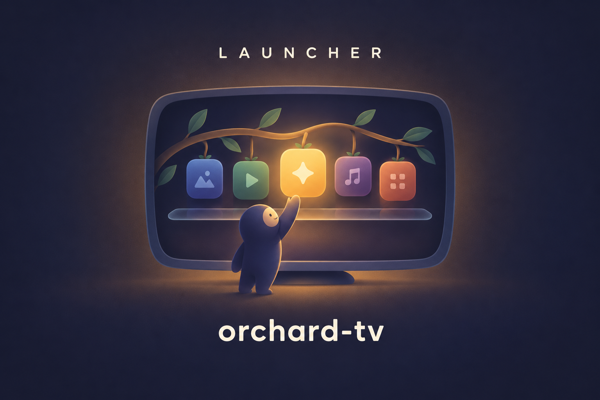</p>

The detox (`scripts/detox.sh`) switches off ad tracking, Amazon's ad-showing screensaver, telemetry and preloaded bloatware, and points the Stick at AdGuard's ad-blocking DNS. Orchard (`tv.orchard.home`) then replaces the home screen with a Top Shelf, a dock, an app grid, a Quick Panel, a time-of-day sky with light and dark themes, a weather chip and a giant-clock screensaver. Its one network call is an optional weather request to Open-Meteo that sends only your city's coordinates (switch it off in Settings). It takes about 1.4 MB and never reads Amazon's recommendations, so none are shown.

## The map

| I want to… | Tool | What it is |
|---|---|---|
| **Block** ads & trackers | [`scripts/detox.sh`](scripts/detox.sh) `dns` | Private DNS to AdGuard (or your own): ad and tracker domains resolve to nothing, in every app |
| **Remove** bloatware | [`scripts/detox.sh`](scripts/detox.sh) `debloat` | 33 listed Amazon packages: 27 disabled, 6 that Fire OS protects restricted by `background` ([list](config/debloat.txt)); nothing deleted |
| **Stop** tracking | [`scripts/detox.sh`](scripts/detox.sh) `privacy` | Ad-tracking limits on; interest-based ads, usage data and metrics upload off |
| **Replace** the home screen | [`app/`](app/) + [`scripts/launcher.sh`](scripts/launcher.sh) `install` | Plain Java, host tests first, then a signed `orchard.apk` installed over Wi-Fi adb |
| **Watch** the sky change | [`app/`](app/) | Wallpaper follows the real sun for your city; light theme by day, dark by night; weather chip with a rain note |
| **Move** to another city | TV Settings > City, or [`scripts/launcher.sh`](scripts/launcher.sh) `city` | Pick from a list, or `city Pune`, or `city <lat> <lon> [label]`; applies live |
| **Dim** the TV with a clock | [`scripts/launcher.sh`](scripts/launcher.sh) `screensaver on` / `off` | Giant thin clock on black; type `SCREENSAVER` to confirm; `off` restores your snapshot |
| **Go back** to stock | [`scripts/launcher.sh`](scripts/launcher.sh) `factory-stock` / `reset-to-stock` | Redirect off and Amazon's home open; `factory-stock` also runs `detox.sh undo all` |
| **Preview** in a browser | [`mockup/`](mockup/) | Open `mockup/index.html`; placeholder art, same layout |

More: [`scripts/tv.sh`](scripts/tv.sh) sends one adb command, [`docs/DETOX.md`](docs/DETOX.md) is the detox guide, [`docs/PLAN.md`](docs/PLAN.md) the design spec, [`docs/learnings.md`](docs/learnings.md) the Fire OS 8 findings.

## Quick start

1. **Enable ADB** on the Stick: Settings > My Fire TV > Developer options > ADB debugging.
2. **Set up the adb client and the Stick's IP** once (venv plus a git-ignored `.env`): see [docs/DETOX.md](docs/DETOX.md).
3. **Approve the adb prompt**: run `scripts/tv.sh --probe` and tap Allow on the TV.
4. **Detox** (rehearse, then run; type `DETOX` to confirm): `scripts/detox.sh all --dry-run`, then `scripts/detox.sh all`.
5. **Build and install the launcher**:

```bash
source tools/env.sh && app/build.sh
scripts/launcher.sh snapshot && scripts/launcher.sh install && scripts/launcher.sh grant
```

6. **Point Home at Orchard**: install [Home on Fire](https://github.com/toolicious/home-on-fire) and choose Orchard as its target.

Ad and tracker domains are blocked, the bloat is off, and Home opens Orchard. (Ads stitched into the video itself, as in Prime Video, YouTube and live sports, cannot be blocked; see the FAQ.) That's it — everything below is detail.

---

## Demo

Rehearsing the detox, then a real build and install (device values removed):

```
$ scripts/detox.sh dns --dry-run
== dns (dns.adguard-dns.com)
would run: settings put global private_dns_mode hostname
would run: settings put global private_dns_specifier dns.adguard-dns.com

$ scripts/detox.sh status
== dns
  global.private_dns_mode=hostname
  global.private_dns_specifier=dns.adguard-dns.com
== debloat
  listed 33: disabled 27, enabled 6, not installed 0
== safety
  no never-disable package is disabled

$ app/build.sh
== host tests
PASS DebugFlagsTest
PASS SolarTest
...
built app/build/orchard.apk  1465712 bytes  permissions: android.permission.INTERNET android.permission.WRITE_SECURE_SETTINGS

$ scripts/launcher.sh install
== pm install -r
Success

$ scripts/launcher.sh status
HoF redirect                   = ON (HoF entry present)
WRITE_SECURE_SETTINGS grant    = yes
HOME vs snapshot               = same
```

Six of the 33 listed packages stay enabled because Fire OS refuses to disable them; the detox reports them as protected and `background` bars them from running in the background. On a real Fire TV Stick, with the apps' own banners:

<table>
  <tr>
    <td>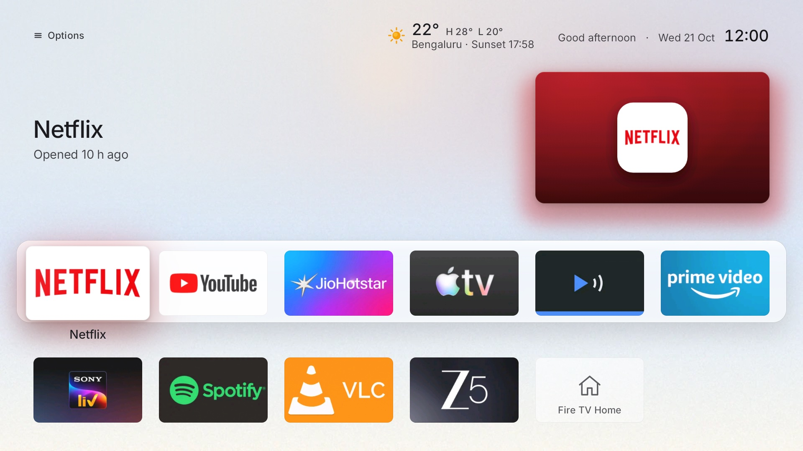</td>
    <td>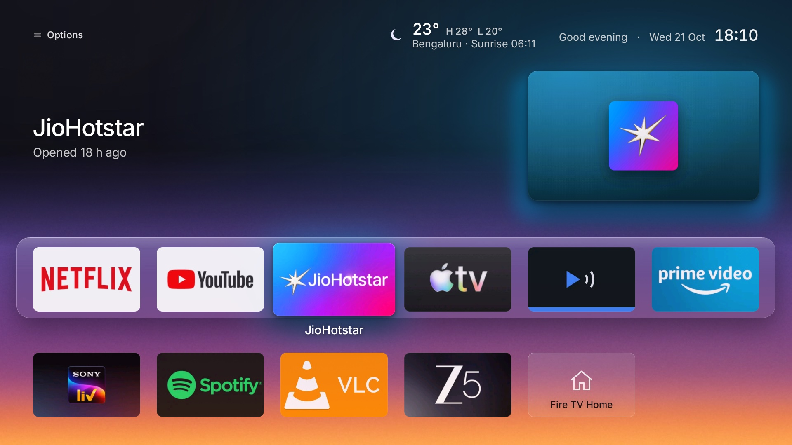</td>
    <td>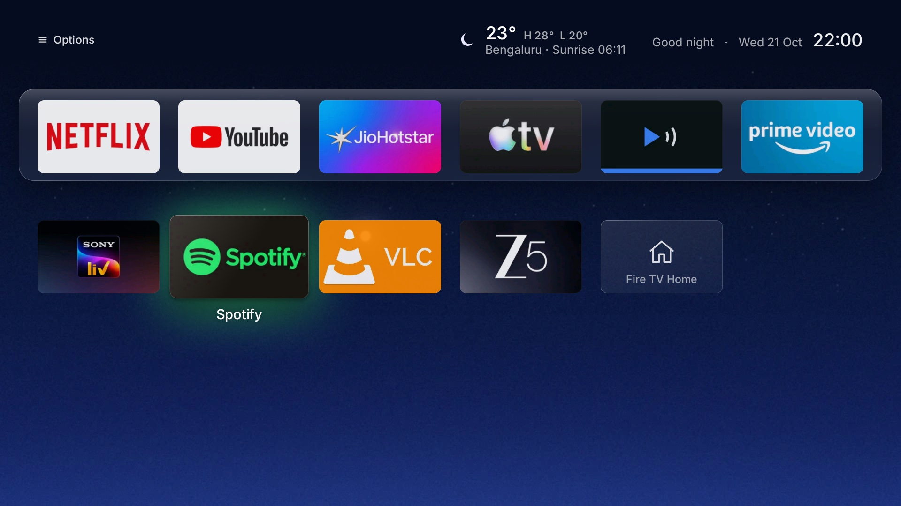</td>
  </tr>
</table>

Quick Panel, reset sheet and Settings (captured in the built-in placeholder-art mode, `debug_art=placeholder`):

<table>
  <tr>
    <td>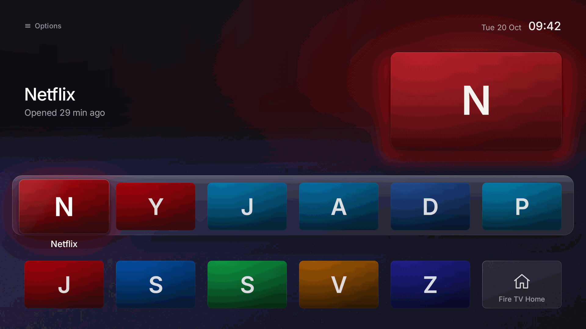</td>
    <td>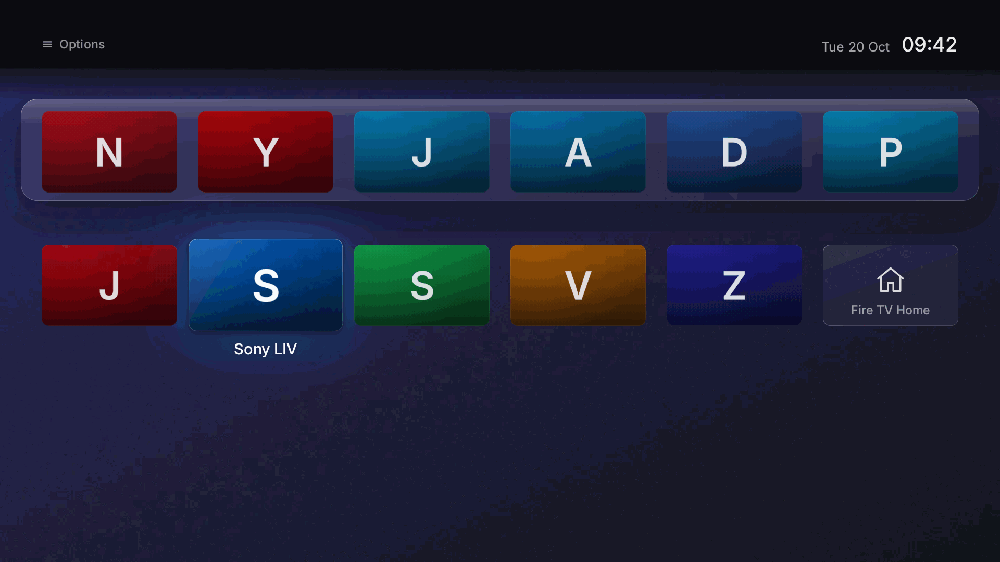</td>
    <td>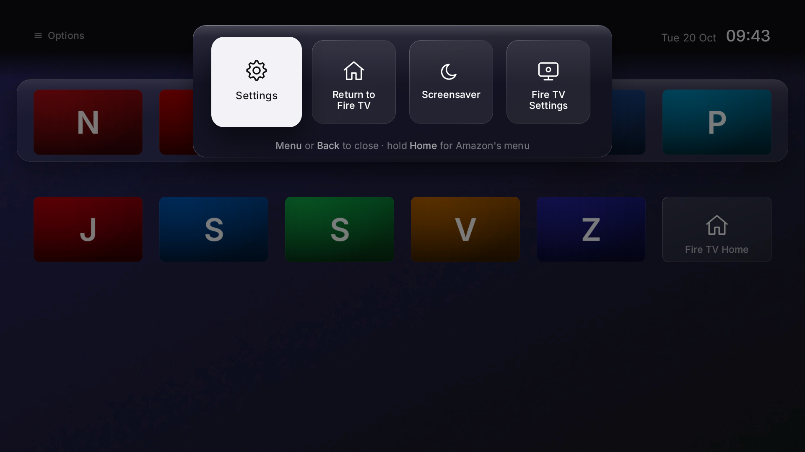</td>
  </tr>
  <tr>
    <td>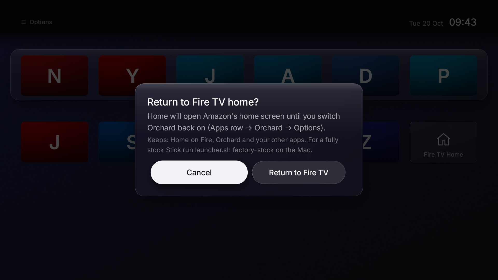</td>
    <td>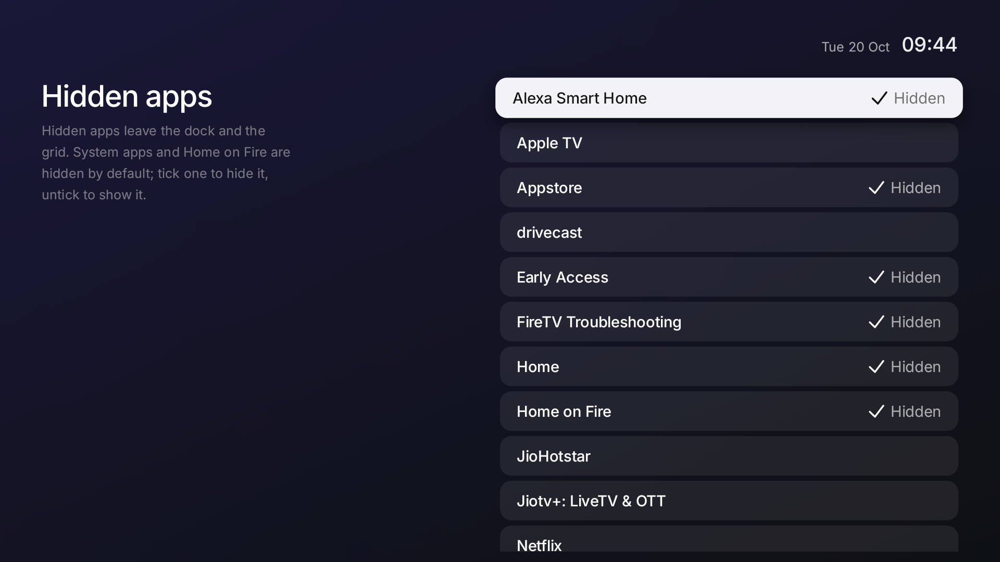</td>
    <td></td>
  </tr>
</table>

---

## How it works

The detox has seven layers, each runnable alone (`scripts/detox.sh <layer>`) and undoable (`scripts/detox.sh undo <layer>`):

| Detox layer | Effect |
|---|---|
| `snapshot` | Saves every setting and package state it touches to git-ignored `backup/detox-pre.txt` |
| `privacy` | Ad-tracking limits on; interest-based ads, usage data and metrics upload off |
| `screensaver` | Amazon's screensaver (can show Prime Video ads) disabled; Android's plain Colors instead |
| `background` | Telemetry and ads packages Fire OS will not disable are barred from running in the background |
| `dns` | Private DNS to AdGuard (or your `DNS_HOST`) |
| `debloat` | 33 listed Amazon packages (27 disable; Fire OS protects 6, restricted by `background`): ACR, ad ID, shopping, Photos, Music, MiniTV, Kids, tutorials, Wi-Fi password upload |
| `updates` | Optional, risky both ways: blocks firmware updates. Never part of `all` |

`config/never-disable.txt` (launcher, platform, input, SystemUI, Settings, providers, Bluetooth) is refused on every disable path, and the typed gates `DEBLOAT`, `UPDATES` and `DETOX` stop a stray run. `detox.sh status` is read-only.

Fire OS ignores third-party Home apps, so Orchard cannot be chosen as the default launcher. [Home on Fire](https://github.com/toolicious/home-on-fire) (GPLv3, installed separately, never copied here) watches for Amazon's home opening through an accessibility service and redirects to Orchard. Orchard asks for two permissions: `WRITE_SECURE_SETTINGS`, which lets its own reset sheet switch that redirect off, and `INTERNET`, used only for the weather request below. The reset tools work in layers, so one failure never strands you:

| Reset layer | Where | What it does |
|---|---|---|
| **A** | In the app | Settings > Return to Fire TV removes the redirect and opens Amazon's home |
| **B** | On the remote | Long-press Home always opens Amazon's home; Orchard never intercepts it |
| **C** | From a Mac | `launcher.sh reset-to-stock`, `restore-home`, `restore-settings`, `factory-stock` (type `STOCK`; also runs `detox.sh undo all`) |
| **D** | Crash failsafe | Three crashing Home launches strip the redirect and open a safe-mode screen |

`--dry-run` prints the TV commands without running them. Last resort is Amazon's Settings > My Fire TV > Reset to Factory Defaults. Orchard's settings live in `orchard.conf`; debug flags go through the launch intent because Android 11 blocks adb from that folder:

```bash
scripts/tv.sh 'am start -n tv.orchard.home/.HomeActivity --es orchard.debug "debug_card=banner;debug_motion=reduced" --es orchard.debug_nonce "$(date +%s)"'
scripts/tv.sh 'am start -n tv.orchard.home/.HomeActivity --ez orchard.debug_clear true --es orchard.debug_nonce "$(date +%s)"'
scripts/tv.sh 'am broadcast -n tv.orchard.home/.DebugReceiver --es unset debug_art'   # live, no nonce, applies at once
```

The nonce is required on a cold start: Android replays `am start` extras as the task's root intent after the process dies, so Orchard ignores extras in `onCreate` unless the nonce is new. A broadcast is never replayed.

---

## Sky, weather and clock

The wallpaper is a sky chosen by the sun's elevation over your city, computed on the TV with the NOAA solar algorithm (no network). Ten pre-rendered frames cross-fade through dawn, day, golden hour, dusk and night, with a soft sun or moon glow. The interface flips between a light and a dark theme around sunrise and sunset, and the Top Shelf greets you by time of day. Settings > Theme chooses Auto (sunset), Light or Dark. Everything moves by alpha and translate only, so a still home screen redraws nothing except the minute tick.

### A day on Orchard

<p align="center">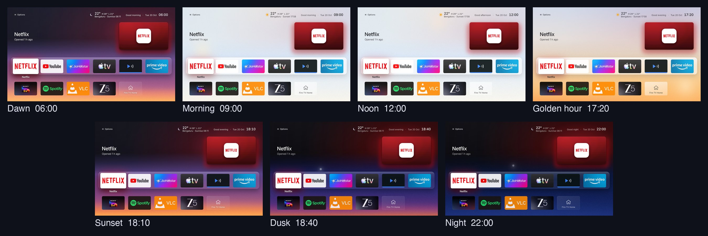</p>
<p align="center"><em>One city, seven moments from 06:00 to 22:00: the sky follows the sun and the interface flips between dark and light.</em></p>

<p align="center">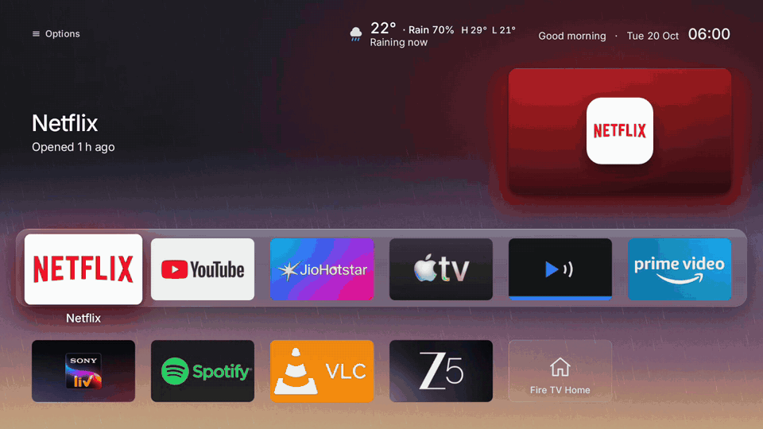</p>
<p align="center"><em>Slow raindrops, only while it rains, over each of the seven times of day.</em></p>

<p align="center">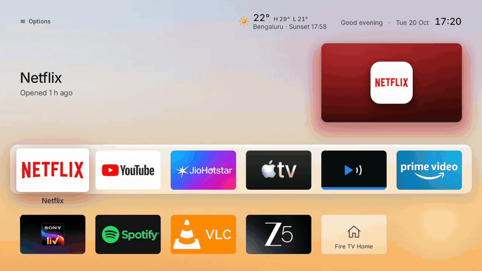</p>
<p align="center"><em>Focus moves along the dock and the Top Shelf glow takes the colour of each app.</em></p>

<table align="center">
  <tr>
    <td>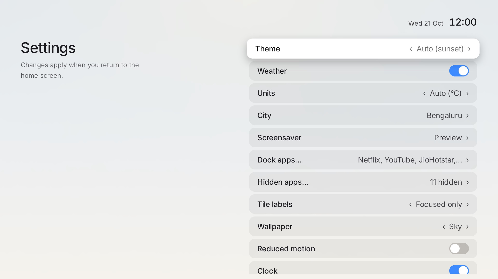</td>
    <td>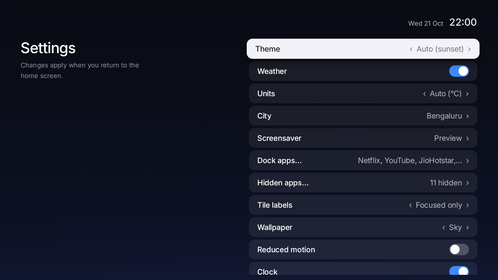</td>
  </tr>
  <tr>
    <td align="center"><em>Settings at noon, light theme.</em></td>
    <td align="center"><em>The same screen at 22:00, dark theme.</em></td>
  </tr>
  <tr>
    <td>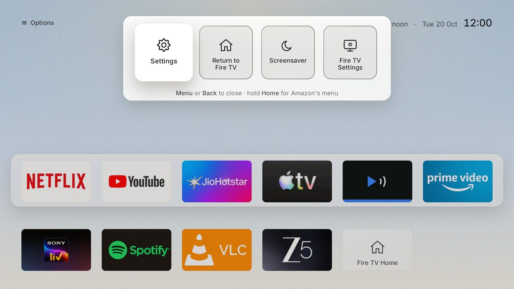</td>
    <td>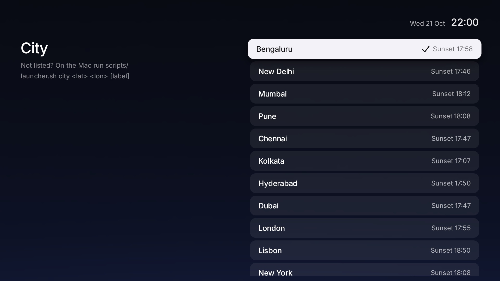</td>
  </tr>
  <tr>
    <td align="center"><em>Quick Panel at noon.</em></td>
    <td align="center"><em>City picker: each city shows today's sunset.</em></td>
  </tr>
</table>

<p align="center">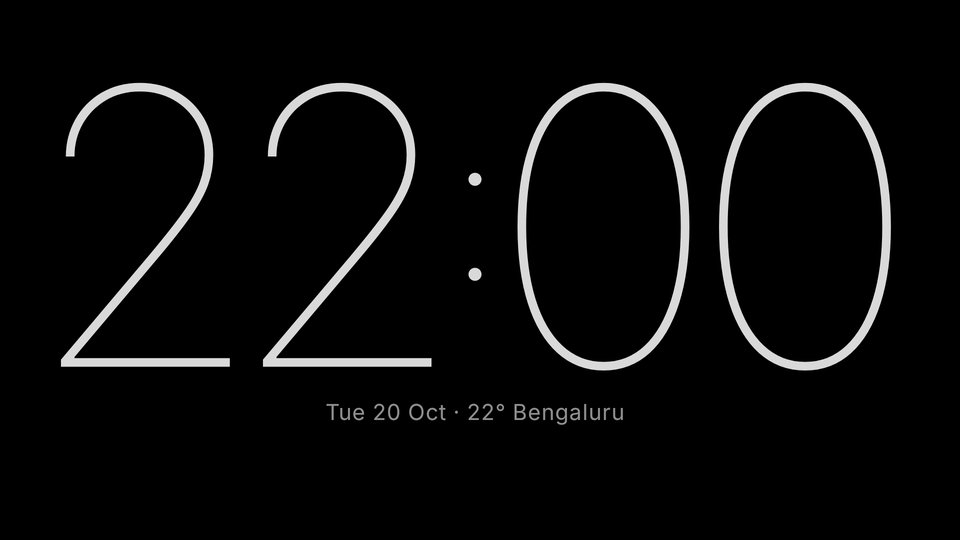</p>
<p align="center"><em>The clock screensaver: the real Fire TV screensaver, running on the Stick.</em></p>

- **Weather.** A chip shows the temperature, today's high and low and the sunset time. When rain is likely a short note appears and slow raindrops fall (only while it rains), and cloud or rain dims the sky one step. Data comes from [Open-Meteo](https://open-meteo.com/) (CC BY 4.0, no key, no account): one request on a background thread at most every 30 minutes, cached on the TV. **What is sent: only your city's coordinates, rounded to about 1 km.** Offline, the chip simply hides. Turn it off in Settings > Weather.
- **City.** The default is Bengaluru. Change it in Settings > City, or from the Mac: `scripts/launcher.sh city Pune` for a listed city, or `scripts/launcher.sh city 51.5072 -0.1276 London` for any place. It applies live, with no restart.
- **Clock screensaver.** A giant thin 24-hour clock on black that drifts a few pixels each minute against burn-in and dims after ten minutes. Orchard Clock replaces Android's plain Colors screensaver once you run `scripts/launcher.sh screensaver on` (type `SCREENSAVER`); `screensaver off` restores your snapshot, or Android's Colors.

Sunrise and sunset use the NOAA solar position equations; weather is by Open-Meteo. Details are in [docs/PLAN.md](docs/PLAN.md) (Revs 4 to 6).

---

## Requirements

```bash
# macOS
brew install openjdk@21 android-commandlinetools python
sdkmanager "platforms;android-30" "build-tools;34.0.0"
```

- **Stick:** Fire TV Stick 4K Plus on Fire OS 8 (Android 11). Tested on one device, Fire OS 8.1.8.5.
- **Mac:** JDK 17+, Python 3 for the adb client.
- **Home on Fire** installed on the Stick (only for the launcher; the detox needs only adb).

> **Gotcha: Fire OS ignores custom Home apps.** Installing Orchard alone changes nothing; Home on Fire plus the adb `WRITE_SECURE_SETTINGS` grant are required. Long-press Home always escapes to Amazon's home, by design.

---

## FAQ

**Can I run just the detox, without the launcher?**
Yes. `scripts/detox.sh all` needs only adb. The launcher and Home on Fire are separate and optional.

**Can the detox brick my Stick?**
Aggressive debloat can; one Stick of this model was reported stuck on the boot logo. The shipped list is conservative, a never-disable list blocks the dangerous packages, and every change is a disable you can reverse with `scripts/detox.sh undo all`.

**Does it block Prime Video, YouTube or live-sports ads?**
No. Those ads are stitched into the stream or served from the video's own domains, so DNS cannot separate them. See [docs/DETOX.md](docs/DETOX.md#what-cannot-be-blocked).

**How do I go back to Fire TV?**
Use Settings > Return to Fire TV in Orchard, long-press Home on the remote, or run `scripts/launcher.sh reset-to-stock`. `factory-stock` also restores the saved settings, re-enables the debloated packages and removes Orchard.

**Does Orchard use the network?**
One optional request: the weather chip asks Open-Meteo for the forecast at your city's coordinates, at most every 30 minutes, with nothing else attached. Settings > Weather off stops it. Nothing else leaves the TV.

**Is the UI 4K or 1080p?**
The Stick renders at 1920x1080 and scales to a 4K panel, so Orchard is laid out for 1080p.

**Will it work on Vega OS sticks?**
No. Vega OS is not Android, so none of this applies.

---

## Credits — built on top of

orchard-tv exists because these projects did the hard research first. Thank you.

| Project | What it contributed | Licence |
|---|---|---|
| [Gathin23/cleanyourtv](https://github.com/Gathin23/cleanyourtv) (formerly tv-vibehack) | The adb client (`tools/adb/tv.py`, `b64push.py`), the Fire OS debloat list behind `config/debloat.txt`, and build ideas | MIT |
| [humblemuzzu/dumbtv](https://github.com/humblemuzzu/dumbtv) | Permissionless launcher patterns (catalogue, config, `build.sh`), the background-restriction idea, and its GOTCHAS notes | MIT |
| [toolicious/home-on-fire](https://github.com/toolicious/home-on-fire) | The Home-button redirect Orchard relies on; integrated as a separate app, never copied | GPLv3 |
| [WB2024/firestrip](https://github.com/WB2024/firestrip) | The do-not-touch package list that shaped `config/never-disable.txt` | MIT |
| [yesrab/Firestick-Cleaner-And-Launcher-Replacer](https://github.com/yesrab/Firestick-Cleaner-And-Launcher-Replacer) | Approach reference for Fire OS 8.1.8.5 | MIT |
| [AdGuard DNS](https://adguard-dns.io/) | The default ad-blocking DNS filter for the `dns` layer | service |
| [hagezi/dns-blocklists](https://github.com/hagezi/dns-blocklists) | Research on Amazon's tracker domains (nothing copied) | GPL-3.0 |
| [Projectivy Launcher](https://play.google.com/store/apps/details?id=com.spocky.projengmenu) by spocky | UX reference; closed source, nothing copied | reference only |
| [Inter](https://github.com/rsms/inter) by Rasmus Andersson | Orchard's typeface (Regular, Medium, SemiBold and Thin subsets) | SIL OFL |
| [Open-Meteo](https://open-meteo.com/) | Weather data for the chip; attribution shown in Settings | CC BY 4.0 |
| [NOAA solar calculator](https://gml.noaa.gov/grad/solcalc/calcdetails.html) | The sunrise, sunset and solar-elevation equations behind `Solar.java` (reimplemented, no code copied) | public domain |
| [Apple tvOS Human Interface Guidelines](https://developer.apple.com/design/human-interface-guidelines/designing-for-tvos) | Design reference only; no Apple assets used | reference only |

See [`THIRD_PARTY_NOTICES.txt`](THIRD_PARTY_NOTICES.txt) for licence texts.

## License

MIT — see [LICENSE](LICENSE). Not affiliated with Apple or Amazon. App names and logos in the screenshots belong to their owners and appear only to show the launcher with real apps. Apple TV and Fire TV are trademarks of their owners. The mockup and the `docs/media/screenshot-*.png` captures use generated placeholder art; real logos appear only in the `docs/media/screenshot-real-*` captures and are not shipped in the app.
